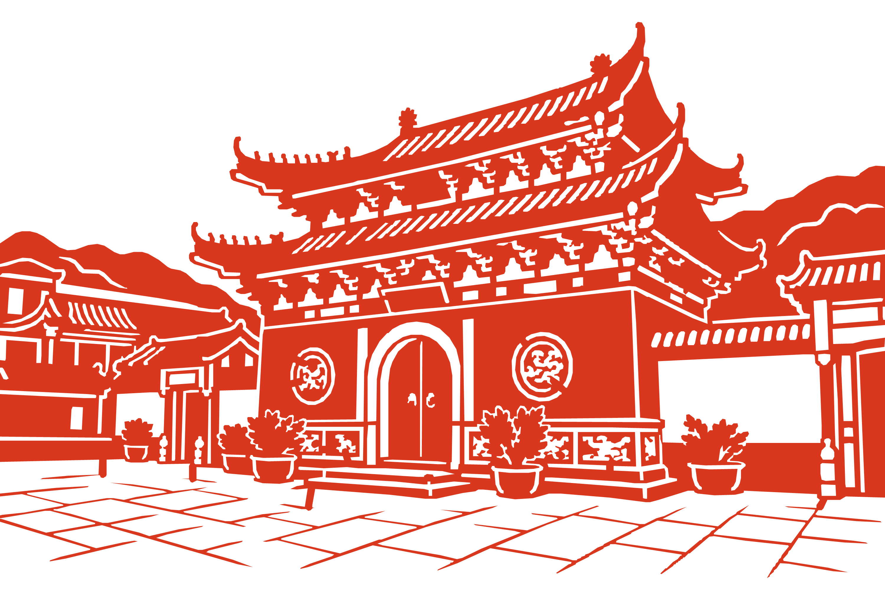
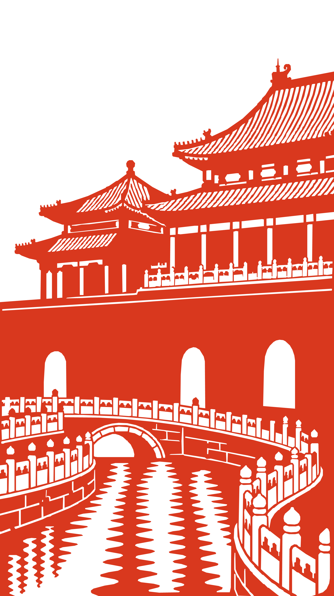

# 剪纸图样生成 · Create Jianzhi Pattern

将实景照片、插画或文字描述转绘为中国红剪纸，输出可用于小红书配图的白底 PNG，以及供打印、编辑与手工剪刻参考的 SVG 矢量图样。

这是一个供 Codex 调用的 Skill，包含转绘提示词、剪纸设计规则与本地导出脚本。默认制作**标准版、正面、中国红 `#D9381E`、纯白背景**，优先保留原图的构图与主体辨识度。

[下载技能 ZIP](https://github.com/echoLYY57/create-jianzhi-pattern/releases/latest/download/create-jianzhi-pattern.zip) · [查看发布版本](https://github.com/echoLYY57/create-jianzhi-pattern/releases) · [下载完整仓库](https://github.com/echoLYY57/create-jianzhi-pattern/archive/refs/heads/main.zip)

## 效果参考

以下为项目迭代测试中的转绘成品。示例提供 PNG 和 SVG，可直接点击查看或下载；原始照片未随仓库发布。

### 建筑庭院：重檐、拱门与山体



保留两层屋檐、中央拱门、两侧院墙与山体轮廓，将斗拱、瓦片、植物和铺地提炼为红白结构。

[查看 PNG](docs/examples/temple-gate.png) · [查看 SVG](docs/examples/temple-gate.svg)

### 故宫水景：建筑、桥梁与水面



保留建筑层次、三处拱门、桥梁与弯曲水岸，以镂空纹样概括栏杆、屋顶和水波。

[查看 PNG](docs/examples/forbidden-city-water.png) · [查看 SVG](docs/examples/forbidden-city-water.svg)

## 可以做什么

- **照片或插画转绘**：识别建筑、人物、动物、植物与场景的主要特征，转换为红白剪纸语言。
- **文字生成剪纸**：根据主题、姿态、构图和指定纹样设计图样。
- **保留主体辨识度**：建筑优先保留屋檐、层次、入口；人物优先保留身份、姿态、发型和主要面部特征。
- **剪纸结构整理**：移除细碎杂点，填补过小孔洞，尝试将独立红色块连接到主体。
- **双格式交付**：输出白底红色 PNG、红色复合路径 SVG，以及 JSON 检查报告。
- **三种复杂度**：默认仅生成标准版；用户指定后可生成简易版、精细版或全部版本。
- **纹样与文字**：根据题材自动匹配吉祥纹样，也支持用户指定；需要保留的文字须由用户提供或确认。

## 下载与安装

1. 点击上方“下载技能 ZIP”，解压文件。
2. 将其中的 `create-jianzhi-pattern` 文件夹放入 Codex 的个人技能目录，例如 Windows 的 `%USERPROFILE%\.codex\skills\`。
3. 确认结构为 `skills/create-jianzhi-pattern/SKILL.md`，不要额外套一层同名文件夹。
4. 开启下一轮对话并输入技能名调用；如果列表尚未刷新，可以重启 Codex。

安装后的文件结构：

```text
create-jianzhi-pattern/
├── SKILL.md
├── agents/openai.yaml
├── references/design-rules.md
├── references/prompt-template.md
└── scripts/process-jianzhi.ps1
```

## 怎么使用

上传图片后输入：

```text
$create-jianzhi-pattern 将这张照片转为标准版剪纸，保留原构图，输出白底中国红 PNG 和 SVG。
```

指定制作方式与尺寸：

```text
$create-jianzhi-pattern 把这张建筑照片做成适合刻刀镂刻的剪纸，保留屋檐和入口特征，成品长边 300 mm。
```

通过文字创作：

```text
$create-jianzhi-pattern 制作一张“喜鹊登梅”剪纸，标准版，枝干与喜鹊连成一体，不加边框，输出 PNG 和 SVG。
```

人物或二次元插画：

```text
$create-jianzhi-pattern 将这张人物插画转为剪纸，保留身份、姿态、发型和表情，用白色镂空表现主要五官，让发饰和随身元素自然连接到主体。
```

## 默认设置

| 项目 | 默认值 |
| --- | --- |
| 复杂度 | 标准版 `standard` |
| 成品方向 | 正面，按需额外制作镜像版 |
| 颜色 | 中国红 `#D9381E`、纯白 `#FFFFFF` |
| 构图 | 尽量保留完整原构图，无自动外框 |
| 成品长边 | 250 mm；细节过密时建议放大或简化 |
| PNG | 长边 3000 px、纯白背景；显示边缘可抗锯齿 |
| SVG | 白底画板与一个红色闭合复合路径，不嵌入位图 |
| 结构版本 | 优先严格连通版 `strict` |
| 吉祥纹样 | 自动匹配，可由用户指定 |

必须保留的独立红色元素如果无法自然连接，可额外提供忠实构图的多片版 `faithful`，并说明需要分别剪刻和定位。

## 制作流程

1. 分析主体、构图、识别特征、文字与可舍弃细节。
2. 使用 Codex 中可用的图像生成能力，制作红白剪纸母版。
3. 按剪纸逻辑安排正形与负形，简化重复纹样，尽量在母版阶段形成连续红色结构。
4. 运行本地导出脚本，清理母版、连接碎片、提取矢量路径。
5. 检查成品视觉与报告，必要时调整母版、放大尺寸或降低复杂度。

提示词模板见 [prompt-template.md](create-jianzhi-pattern/references/prompt-template.md)，设计规则见 [design-rules.md](create-jianzhi-pattern/references/design-rules.md)。

## 运行环境与单独导出

图像母版生成需要支持图像生成／编辑能力的 Codex 环境。Skill 本身不包含独立图像生成模型。

当前本地后处理脚本依赖 **Windows PowerShell 5.1 与 Windows `System.Drawing`**。请使用 `powershell.exe` 执行；当前版本未针对 PowerShell 7、macOS 或 Linux 验证。

已经拥有红白母版时，可在仓库目录中运行：

```powershell
powershell.exe -NoProfile -ExecutionPolicy Bypass -File ".\create-jianzhi-pattern\scripts\process-jianzhi.ps1" `
  -InputPath ".\master.png" `
  -OutputStem ".\output\my-jianzhi-standard-strict" `
  -Complexity standard `
  -Variant strict `
  -LongEdgeMm 250 `
  -LongEdgePx 3000
```

输出 `.png`、`.svg`、`.report.json` 三个文件。复杂度可选 `simple`、`standard`、`fine`；结构版本可选 `strict`、`faithful`。

## 测试结果与使用边界

| 示例 | PNG 尺寸 | 修复前红色连通片 | 修复后红色连通片 | 自动桥接数 |
| --- | --- | ---: | ---: | ---: |
| 建筑庭院 | 3000 × 2000 | 19 | 1 | 18 |
| 故宫水景 | 1688 × 3000 | 12 | 1 | 11 |

以上数值来自生成时的栅格掩膜检查。报告中的 `pass` 表示严格版在该检查阶段只剩一个红色连通片，**不代表所有细桥、镂空和最终平滑后的 SVG 都已通过实物剪刻验证**。

当前脚本会清理小孔并为新增桥接设置目标宽度，但不会全面测量原图已有细桥与孔洞的最窄处。PNG 与 SVG 还采用不同的轮廓绘制方式，因此打印前应对照 SVG 复核局部细节。

若标准版新增桥接超过 20 处，或修复前红色连通片超过 40 个，Skill 会提示重新简化母版。建筑类细节通常更适合刻刀；纯剪刀制作时可选择简易版或更大的成品尺寸。

参考图展示转绘效果；请按实际纸张、工具与熟练度检查图样，再开始剪刻。
